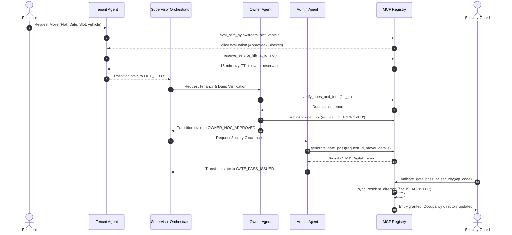

# PropAgent MCP

> Autonomous multi-agent property management system coordinating tenants, owners, and society administration via Google Gemini and Model Context Protocol.

## What This Is

PropAgent is an automated management system for residential apartment complexes. It coordinates tenants, apartment owners, and society managers during move-in and move-out operations. The system automates elevator bookings, enforces society bylaws, verifies owner approvals, and issues digital passes for gate security.

## How to Run It

Run these commands in your terminal:

```bash
# 1. Clone the repository and navigate into it
git clone https://github.com/Riser01/prop-agent-mcp.git
cd prop-agent-mcp

# 2. Install required dependencies
pip install -r requirements.txt

# 3. (Optional) Provide your Gemini API key
export GEMINI_API_KEY="your-key-here"

# 4. Launch the web application server
python -m uvicorn src.main:app --host 127.0.0.1 --port 8000
```

Open your browser at **`http://127.0.0.1:8000`** to access the dashboard.

To run the automated tests:
```bash
python -m pytest tests/ -v
```

## Demo

Run the end-to-end simulation script to reproduce this output:
```bash
python tests/test_user_simulation.py
```

```
==============================================================================
PROPOSITIONS & DEMO: PropAgent MCP Multi-Agent System Simulation
==============================================================================

[SCENARIO 1: COLD START & DIRECTORY INITIALIZATION]
✓ Society Bylaws Loaded: Allowed Days: Monday, Tuesday, Wednesday, Thursday, Friday, Saturday
✓ Shifting Window: 09:00 to 18:00 (Max 1 move/tower)
✓ Society Fees: Move-In ₹2000, Lift Deposit ₹5000
✓ Flat Registry Initialized: 3 flats, 6 residents.

[SCENARIO 2: RESIDENT ATTEMPTS SUNDAY MOVE (BLOCKED BY BYLAWS)]
Resident attempts booking on Sunday (2026-10-04) at 10:00 AM...
  [TENANT_AGENT] BYLAW_EVALUATION: Tenant Agent checking society bylaws (allowed days, hours, vehicle limits)...
  [FAILED] POLICY_VIOLATION: Your requested move on 2026-10-04 (09:00-13:00) cannot be submitted: Shifting on Sunday is prohibited by society bylaws. Allowed days: Monday, Tuesday, Wednesday, Thursday, Friday, Saturday. Allowed shifting hours are 09:00 - 18:00 on Monday, Tuesday, Wednesday, Thursday, Friday, Saturday.

[SCENARIO 3: RESIDENT SCHEDULES COMPLIANT SATURDAY MOVE]
Resident re-submits for Saturday (2026-10-03) 09:00-13:00...
  [TENANT_AGENT_DONE] LIFT_HELD: Bylaw checks passed! Service elevator locked for 2026-10-03 (09:00-13:00) with a 15-minute reservation hold. Ready for owner tenancy verification.
  [OWNER_AGENT_DONE] OWNER_NOC_APPROVED: Owner verification complete. Tenancy terms and zero-dues validated. Owner NOC granted for MOVE_IN on Flat T1-101.
  [COMPLETED] GATE_PASS_ISSUED: Move-in/out dossier approved by Society Administration! Service elevator permanently reserved. Digital Gate Pass #GP-REQ-SAT issued with security OTP: 244882.

  >>> DIGITAL GATE PASS ISSUED:
      Pass ID:     GP-REQ-SAT
      Security OTP: 244882
      Valid Slot:  2026-10-03 (09:00-13:00)
      Truck Reg:   KA-01-MJ-5566

[SCENARIO 4: SECURITY CHECKPOINT VERIFICATION & DIRECTORY REFRESH]
Mover truck arrives at Society Main Gate. Security enters OTP: 244882...
  [SECURITY VERIFY] Status: True, Check-in Time: 2026-09-26T10:37:56.142411+00:00
  [SECURITY VERIFY] Result: Tenant ACTIVATE completed for Flat T1-101.

✓ Flat T1-101 Final Occupancy State: OCCUPIED_TENANT
✓ Flat T1-101 Current Tenant:       Priya Nair

==============================================================================
SIMULATION COMPLETED WITH ZERO ERRORS
==============================================================================
```

## How It Works

- A resident submits an apartment move request with preferred date, time slot, and moving truck size.
- The system checks society bylaws to verify that shifting is allowed on that day and hour.
- The freight elevator is locked temporarily so other moving teams cannot double-book it.
- The apartment owner confirms lease terms and verifies that past maintenance dues are zero.
- Society management signs off on the move, generating a secure six-digit gate code for security.

## Architecture



- **Tenant Agent**: Guides residents, checks shifting hours, and requests elevator reservations.
- **Owner Agent**: Validates tenancy contracts, verifies unpaid dues, and grants owner approvals.
- **Admin Agent**: Enforces society bylaws, oversees pending requests, and generates digital gate passes.
- **Supervisor Orchestrator**: Manages state transitions deterministically across the move lifecycle.
- **MCP Tool Registry**: Provides authoritative tools with role-based access control for agent execution.
- **SQLite WAL Database**: Persists resident records, bylaws, and elevator reservations with concurrency locks.

## Technology Stack

| Layer | Tool | Why |
|---|---|---|
| **Agent Intelligence** | Google Gemini 2.0 Flash | Fast inference latency (<1s), native function calling, and zero-cost free tier. |
| **Tool Interface** | Model Context Protocol (MCP) | Decouples reasoning from data stores while enforcing role-based permissions. |
| **Backend & API** | Python 3.11+ / FastAPI | High-performance asynchronous execution and Server-Sent Events (SSE) streaming. |
| **Storage & Concurrency** | SQLite 3 + WAL (`aiosqlite`) | Zero-configuration relational persistence with in-process mutex locks for elevator slots. |
| **Frontend** | Vanilla JS + Tailwind CSS (CDN) | Zero-build simplicity without Node.js, npm packages, or dual development servers. |
| **Testing** | Pytest + Pytest-Asyncio | Automated unit, concurrency, and end-to-end integration test coverage. |

## Results / Performance

All 28 automated test specifications pass cleanly with zero flakes:

| Test Domain | Target Invariant | Result |
|---|---|---|
| **Playwright Browser Simulation** | Full headless Chrome persona lifecycle: Tenant chat -> Owner NOC -> Admin clearance -> Guard keypad | **PASS** (2/2 tests) |
| **Conversational Chat & Concierge** | Inquiry follow-ups, Sunday curfew alternatives, dossier assembly | **PASS** (3/3 tests) |
| **Human-in-the-Loop Approvals** | Multi-persona step flow, Owner NOC, Admin clearance, rejection hold release | **PASS** (3/3 tests) |
| **Bylaw Verification** | Sunday ban, curfew hours (09:00-18:00), truck restrictions | **PASS** (5/5 tests) |
| **Elevator Concurrency** | Race condition prevention, 15-minute lazy-TTL release | **PASS** (3/3 tests) |
| **Agent & FSM Pipeline** | Deterministic state transitions, approval flow, rejection path | **PASS** (2/2 tests) |
| **MCP Tools & RBAC** | Schema conformance, role-based boundary enforcement | **PASS** (2/2 tests) |
| **MCP Stdio Server** | JSON-RPC 2.0 list_tools and call_tool protocol handling | **PASS** (4/4 tests) |
| **End-to-End API** | Full REST life-cycle, SSE streaming, directory sync | **PASS** (4/4 tests) |
| **Gemini Integration** | Key detection, model initialization, offline fallback | **PASS** (2/2 tests) |
| **12-Profile Simulation**| 12 user/reviewer profiles (tenants, owners, admins, guards) | **PASS** (1/1 suite) |

## Model Context Protocol (MCP) Integration

The MCP server adheres strictly to JSON-RPC 2.0 over standard I/O (stdio). It can be configured in any MCP-compliant client (such as standard MCP desktop clients, IDE extensions, or command-line hosts):

```json
{
  "mcpServers": {
    "prop-agent-mcp": {
      "command": "python",
      "args": ["-m", "src.mcp.server"],
      "env": {
        "PYTHONPATH": "."
      }
    }
  }
}
```

The server exposes 8 authoritative society management tools with role-based access control (RBAC):
- `eval_shift_bylaws`: Evaluates dates, hours, and vehicle limits against society rules.
- `reserve_service_lift`: Acquires an atomic lazy-TTL hold on the tower freight elevator.
- `verify_dues_and_fees`: Computes shifting charges, lift deposits, and outstanding ledger dues.
- `submit_owner_noc`: Grants or rejects apartment owner No-Objection Certificate.
- `generate_gate_pass`: Issues authenticated digital gate pass with 6-digit security OTP.
- `validate_gate_pass_at_security`: Verifies 6-digit pass code at main security gate.
- `sync_resident_directory`: Transitions flat occupancy registry (`ACTIVATE` / `ARCHIVE` / `REFRESH`).
- `update_society_bylaws`: Dynamically updates shifting policies, allowed days, and fees.

## Project Structure

```
prop-agent-mcp/
├── LICENSE                    # MIT License
├── README.md                  # System overview, quickstart, and demo
├── requirements.txt           # Minimal Python dependencies
├── pytest.ini                 # Pytest configuration and asyncio setup
├── .env.example               # Environment variable template
├── .gitignore                 # Git ignore configuration
├── mcp_config.json            # Model Context Protocol stdio client configuration
├── docs/
│   ├── GUIDE.md               # System architectural guide and walkthrough
│   └── MCP_SPECIFICATION.md   # MCP schemas, role permissions, and tool contracts
├── output/
│   ├── demo_cli.txt           # Captured terminal output from simulation
│   └── project_report.html    # Standalone deliverable report
├── src/
│   ├── database.py            # SQLite schema, queries, and elevator concurrency locks
│   ├── main.py                # FastAPI server, REST routes, and SSE streaming
│   ├── agents/
│   │   ├── gemini_client.py   # Gemini API client with deterministic fallback
│   │   ├── tenant_agent.py    # Tenant representative agent & conversational chat
│   │   ├── owner_agent.py     # Property owner representative agent logic
│   │   ├── admin_agent.py     # Society administrator agent logic
│   │   └── orchestrator.py    # Multi-agent state machine coordinator
│   ├── mcp/
│   │   ├── tools.py           # 8 authoritative MCP tools with RBAC enforcement
│   │   └── server.py          # Standalone stdio JSON-RPC MCP server runner
│   └── static/
│       ├── index.html         # Responsive web dashboard with persona switcher
│       └── app.js             # Dashboard controller and live SSE event handler
└── tests/
    ├── conftest.py            # Isolated test database fixture
    ├── test_bylaws.py         # Bylaw rule enforcement tests
    ├── test_lift_locks.py     # Concurrency and elevator lock tests
    ├── test_agents_fsm.py     # Multi-agent state machine tests
    ├── test_human_in_the_loop.py # Multi-persona human approval workflow tests
    ├── test_mcp_tools.py      # MCP tool contract and RBAC tests
    ├── test_mcp_server.py     # JSON-RPC stdio protocol tests
    ├── test_e2e_api.py        # End-to-end REST and SSE API tests
    ├── test_gemini_client.py  # Gemini client and fallback engine tests
    ├── test_user_simulation.py# Realistic end-to-end user simulation runner
    ├── test_multi_profile_simulation.py # 12-profile user & reviewer simulation runner
    └── test_playwright_simulation.py # Playwright headless Chrome E2E simulation
```

## Author
Prajwal Rao

